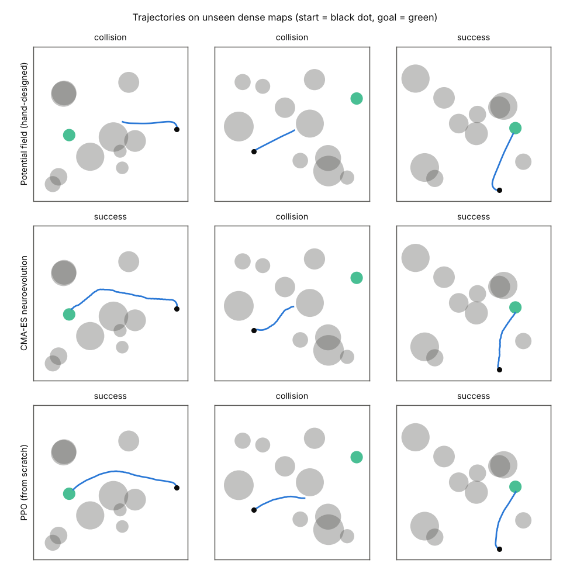
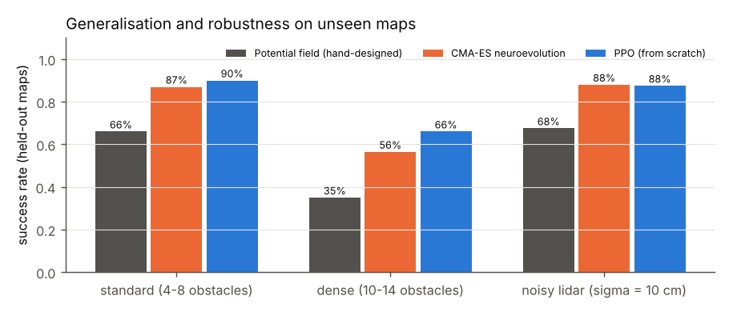
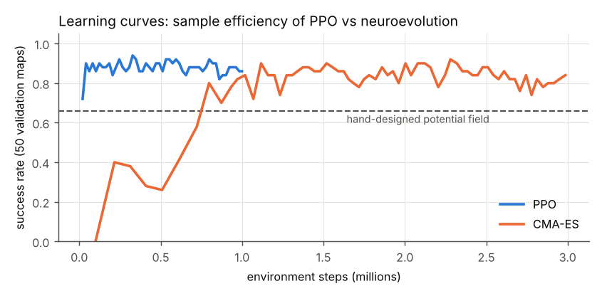

# Learning robot navigation: PPO from scratch vs neuroevolution (CMA-ES)


   

A differential-drive robot with a 16-ray 2D lidar must reach a goal in an arena full of obstacles.
**Every episode is a new random map**, so the robot cannot memorise a route: it has to learn a general
reactive navigation behaviour. Two learning paradigms are compared on exactly the same task:

* **Reinforcement learning:** Proximal Policy Optimization, **implemented from scratch** in PyTorch (no RL library).
* **Evolutionary robotics:** the weights of a small neural controller are optimised by **CMA-ES**, without gradients.
* **Reference:** a hand-designed potential-field controller (attraction to the goal, repulsion from obstacles).



## Environment (`robotnav/env.py`, Gymnasium API)

| | |
|---|---|
| Arena | 10 m × 10 m, walls + 4 to 8 random circular obstacles (radius 0.4–1 m) |
| Observation (20) | 16 lidar distances (range 3 m, vectorised ray casting), goal distance, cos/sin of the goal bearing, current speed |
| Action (2, continuous) | linear speed (0 to 1 m/s) and angular speed (±2.5 rad/s) commands |
| Reward | +10 × metres gained towards the goal, −0.01 per step, small penalty near obstacles, +10 goal / −10 collision |
| Episode end | goal reached, collision, or 400 steps (40 s) |

The environment passes Gymnasium's `check_env`, and the unit tests check the lidar geometry and collisions.

## Results

Final evaluation on **200 maps never seen during training** (seeds disjoint from training and validation),
plus two harder settings that were **never used for training**: dense maps (10–14 obstacles) and a lidar with
10 cm Gaussian noise.

| Controller | Standard maps | Dense maps | Noisy lidar | Training budget |
|---|---:|---:|---:|---|
| Potential field (hand-designed) | 66 % | 35 % | 68 % | – |
| CMA-ES neuroevolution (738 weights) | 87 % | 56 % | 88 % | 3.0 M steps, 11 min |
| **PPO from scratch** (5.6 k actor weights) | **90 %** | **66 %** | **88 %** | 1.0 M steps, 7 min |

Success rate = goal reached without collision. Training on a laptop CPU (1 thread).





**What the results show**

* Both learned controllers clearly beat the hand-designed one, which gets trapped between close obstacles.
* **Sample efficiency:** PPO reaches 90 % validation success after only ~40 k steps; CMA-ES needs ~0.8 M steps to pass 80 %.
  Gradient-based RL reuses every transition; evolution only sees one number (the fitness) per episode.
* CMA-ES is still attractive: no value function, no hyper-sensitive learning rate, trivially parallel
  (each candidate is evaluated independently), and a much smaller network.
* **Robustness:** lidar noise barely hurts the learned policies (the training maps are random, so the
  policies are already robust to variations). Dense maps are a real distribution shift: all methods drop, PPO the least.
  Curriculum learning on obstacle density would be the next step.

## PPO implementation (`robotnav/ppo.py`)

~150 readable lines: Gaussian actor-critic (2 × 64 tanh), GAE (γ = 0.99, λ = 0.95), clipped surrogate (ε = 0.2),
advantage normalisation, orthogonal initialisation, gradient clipping, linear learning-rate decay, and correct handling
of **time-limit truncation** (bootstrapping with V(s′) instead of treating the timeout as a terminal state).

## Run it

```bash
pip install -r requirements.txt
python -m pytest -q tests                                       # 5 tests, ~2 s
python run_experiments.py --ppo-steps 1000000 --es-steps 3000000  # ~20 min on a laptop CPU
```
Trained weights are in `models/` (`ppo.pt`, `cmaes.npy`); all numbers are written to `results/results.json`.

## Limits and next steps

One training seed per method (variance between seeds not measured yet); a 2D kinematic model (no dynamics, no
wheel slip). Next: several seeds, curriculum on obstacle density, recurrent policy for partial observability,
transfer to a physics simulator (e.g. PyBullet / Webots).

## References

* Schulman et al., *Proximal Policy Optimization Algorithms*, 2017.
* Schulman et al., *High-Dimensional Continuous Control Using Generalized Advantage Estimation*, ICLR 2016.
* Hansen & Ostermeier, *Completely Derandomized Self-Adaptation in Evolution Strategies*, Evolutionary Computation 2001.
* Salimans et al., *Evolution Strategies as a Scalable Alternative to Reinforcement Learning*, 2017.
* Huang et al., *The 37 Implementation Details of Proximal Policy Optimization*, ICLR Blog Track 2022.

---
Author: **Gaya Lahouazi**, M2 AI2D (Sorbonne Université). Links with the IAR course (AI for robotics:
reinforcement learning and evolutionary robotics).
